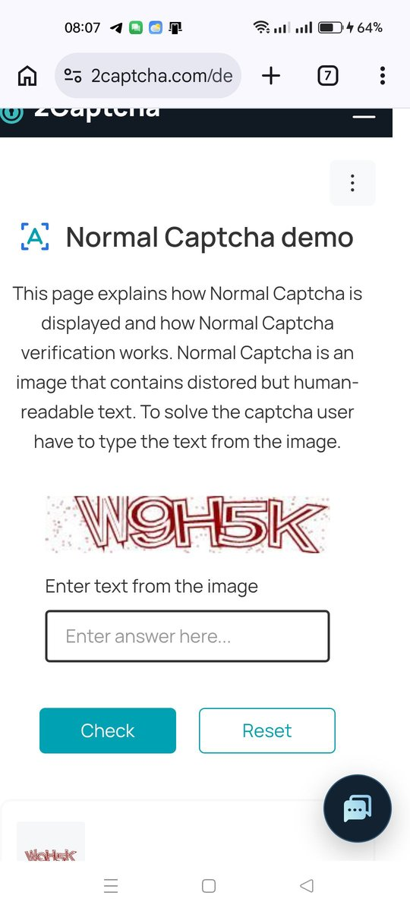
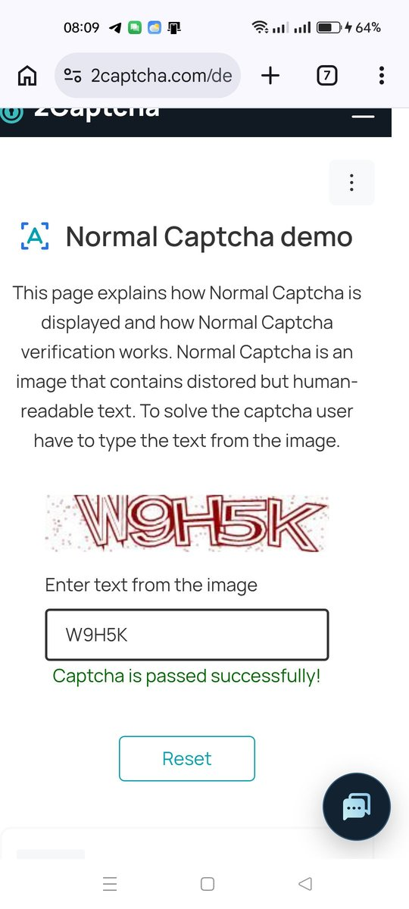
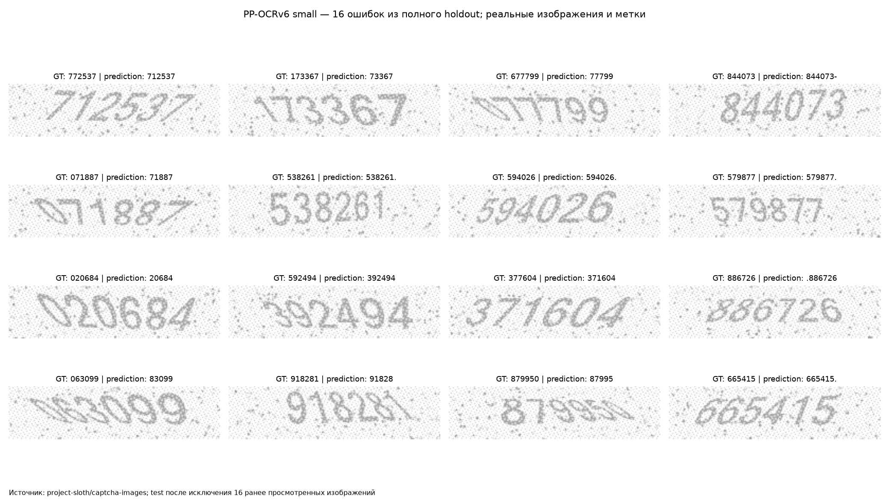

# Скриншоты работы

Прогон 22.10.2026 на телефоне по USB ADB (Chrome, экран 1080×2400),
профиль `phone-profile-demo.json`, форма
[Normal Captcha demo](https://2captcha.com/demo/normal). Модель PP-OCRv6 small
на CPU компьютера, платных вызовов нет.

## 1. Форма перед распознаванием

Наблюдатель находит заголовок `Normal Captcha demo`, поле ответа и кнопку
`Check` по UI XML.



## 2. Вырезка по ROI

Картинка вырезается по нормированной области `roi` из профиля и передаётся
в модель.


Ответ модели: `W9H5K`, уверенность 0.9994.

## 3. Ответ принят

Ответ введён, текст в поле проверен, нажата `Check`; найден признак успеха
`Captcha is passed successfully!`.



Журнал сеанса (`runs/readme-demo/events.jsonl`, сокращённо):

```text
05:08:57Z INFO    Запуск наблюдения; Ctrl+C — остановить   {"profile": "phone-profile-demo.json"}
05:08:58Z INFO    Телефон подключён через ADB              {"serial": "a0eb3b50"}
05:08:59Z INFO    Модель загружена; SHA-256 проверен       {"load_ms": 906}
05:09:03Z WARNING Текст в поле не совпал с ответом; отправка отменена
05:09:03Z WARNING Наблюдение: input_not_submitted          {"attempt": 1}
05:09:09Z INFO    Наблюдение: submitted                    {"raw": "W9H5K", "score": 0.99944, "attempt": 2}
05:09:11Z INFO    Наблюдение: accepted
05:09:14Z INFO    Наблюдение: session_end                  {"frames": 6, "elapsed_seconds": 15.25, "attempts": 2}
```

Первая попытка отменена защитой: введённый текст не совпал с ответом, поэтому
`Check` не нажимался. Вторая попытка прошла.

## Ожидание вместо обработки

Если запустить с `phone-profile.json` при открытой демоформе, наблюдатель
остаётся в состоянии `waiting`: заголовок формы не совпадает с `title` профиля.
Это не зависание: запись `waiting` показывает ожидаемый заголовок, а раз
в 30 секунд пишется `heartbeat`:

```text
05:09:29Z INFO Ожидание: на экране не найден заголовок из выбранного профиля {"status": "waiting", "expected_title": "confirm you['’]re human|...", "package": "com.android.chrome"}
05:10:00Z INFO Цикл наблюдения активен {"status": "heartbeat", "current_status": "waiting", "frames": 17}
```

Для демоформы запускайте с `--profile phone-profile-demo.json`.

## Ошибки модели на holdout

Точность на holdout: 1876 из 1984 (94.6 %, CER 1.0 %). 16 примеров ошибок:


